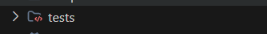

# 🚀 How to Run ConnectGuidance Application

## Quick Start

### 1. Open Terminal in Project Directory
```powershell
cd "c:\School works\4yr_firstsem\connectguidance_django"
```

### 2. Activate Virtual Environment
```powershell

```

If you get execution policy error:
```powershell
Set-ExecutionPolicy -ExecutionPolicy RemoteSigned -Scope CurrentUser
```

### 3. Start the Development Server
```powershell
python manage.py runserver
```

Or specify the port:
```powershell
python manage.py runserver 127.0.0.1:8000
```

### 4. Open Browser
Navigate to: **http://127.0.0.1:8000/**

---

## 🔐 Login Credentials

### Administrator
- **Email:** admin@guidance.edu
- **Password:** AdminPassword123!
- **Access:** Full system administration, user management, analytics, audit logs

### Counselor #1
- **Email:** counselor@guidance.edu
- **Password:** CounselorPassword123!
- **Access:** Appointment management, case notes, mood alerts

### Counselor #2
- **Email:** counselor2@guidance.edu
- **Password:** CounselorPassword123!
- **Access:** Appointment management, case notes, career counseling

### Receptionist
- **Email:** receptionist@guidance.edu
- **Password:** ReceptionPassword123!
- **Access:** Walk-in booking, student search, appointment scheduling

### Student #1
- **Email:** student@university.edu
- **Password:** StudentPassword123!
- **Access:** Book appointments, mood check-ins, AI chatbot, profile

### Student #2
- **Email:** student2@university.edu
- **Password:** StudentPassword123!
- **Access:** Book appointments, mood check-ins, AI chatbot, profile

---

## 📍 Important URLs

| URL | Description |
|-----|-------------|
| http://127.0.0.1:8000/ | Landing Page |
| http://127.0.0.1:8000/login/ | Login Page |
| http://127.0.0.1:8000/register/ | Student Registration |
| http://127.0.0.1:8000/student/ | Student Dashboard |
| http://127.0.0.1:8000/counselor/ | Counselor Workspace |
| http://127.0.0.1:8000/receptionist/ | Receptionist Dashboard |
| http://127.0.0.1:8000/admin-panel/ | Admin Panel |
| http://127.0.0.1:8000/admin/ | Django Admin (Superuser) |

---

## 🛠️ Common Commands

### Database Migrations
```powershell
# Apply migrations
python manage.py migrate

# Create new migrations after model changes
python manage.py makemigrations
```

### Create Superuser (Django Admin)
```powershell
python manage.py createsuperuser
```

### Seed Test Data
```powershell
python manage.py seed_roles
```

### Collect Static Files (for production)
```powershell
python manage.py collectstatic
```

### Run Django Shell
```powershell
python manage.py shell
```

### Check for Issues
```powershell
python manage.py check
```

---

## 🔧 Troubleshooting

### Port Already in Use
If port 8000 is busy, use a different port:
```powershell
python manage.py runserver 8080
```

### Virtual Environment Not Activating
Try:
```powershell
.\.venv\Scripts\Activate.ps1
 python manage.py runserver
```

### CSS Not Loading
Clear cache and reload:
1. Press `Ctrl + Shift + R` in browser (hard refresh)
2. Or run: `python manage.py collectstatic --clear`

### Database Locked Error
Close any other processes accessing `db.sqlite3` and restart

### Module Not Found Error
Reinstall dependencies:
```powershell
pip install -r requirements.txt
```

---

## 🌐 Development vs Production

### Development (Current Setup)
- SQLite database (`db.sqlite3`)
- `DEBUG=True` in settings
- Django serves static files
- Console email backend

### Production Checklist
- [ ] Set `DEBUG=False`
- [ ] Configure PostgreSQL/Supabase
- [ ] Set strong `SECRET_KEY`
- [ ] Configure proper `ALLOWED_HOSTS`
- [ ] Set up SMTP email
- [ ] Use WhiteNoise or CDN for static files
- [ ] Add AI API keys for chatbot
- [ ] Set up SSL/HTTPS

---

## 🎯 Quick Test Flow

1. **Start server** → `python manage.py runserver`
2. **Open** → http://127.0.0.1:8000/
3. **Login as Student** → student@university.edu / StudentPassword123!
4. **Book an Appointment** → Select counselor, date, time, concern
5. **Check Mood** → Submit mood check-in
6. **Login as Counselor** → counselor@guidance.edu / CounselorPassword123!
7. **View Appointments** → See pending appointments
8. **Confirm Appointment** → Change status to confirmed
9. **Write Case Note** → Add encrypted clinical notes
10. **Login as Admin** → admin@guidance.edu / AdminPassword123!
11. **View Dashboard** → See analytics and charts

---

## 🔄 Stopping the Server

Press `Ctrl + C` in the terminal running the server

---

## 📝 Environment Variables

Located in `.env` file:

```env
DJANGO_SECRET_KEY=your-secret-key
DJANGO_DEBUG=True
DJANGO_ALLOWED_HOSTS=localhost,127.0.0.1

# Database (currently using SQLite fallback)
# DATABASE_URL=postgresql://...

# Encryption
ENCRYPTION_KEY=your-32-byte-hex-key

# AI Chatbot (optional)
GROQ_API_KEY=
ANTHROPIC_API_KEY=

# Email (console backend for dev)
# Configure SMTP for production
```

---

## 📚 Additional Resources

- **Django Documentation:** https://docs.djangoproject.com/
- **Project Documentation:** See `docs/` folder
- **ERD:** See `docs/ERD.md`
- **Features:** See `FEATURES.md`
- **Architecture:** See `.agents/tasks/` for design docs

---

## 🆘 Need Help?

1. Check Django server output for error messages
2. Review `.env` configuration
3. Ensure database migrations are applied
4. Verify virtual environment is activated
5. Check Python version: `python --version` (should be 3.10+)

---

**Happy Coding! 🎓**
